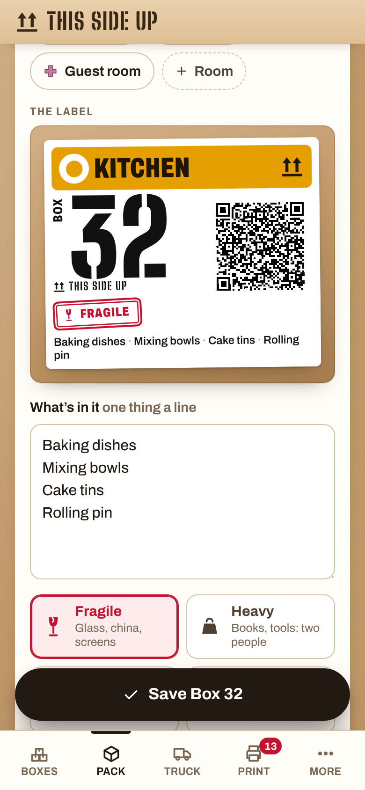
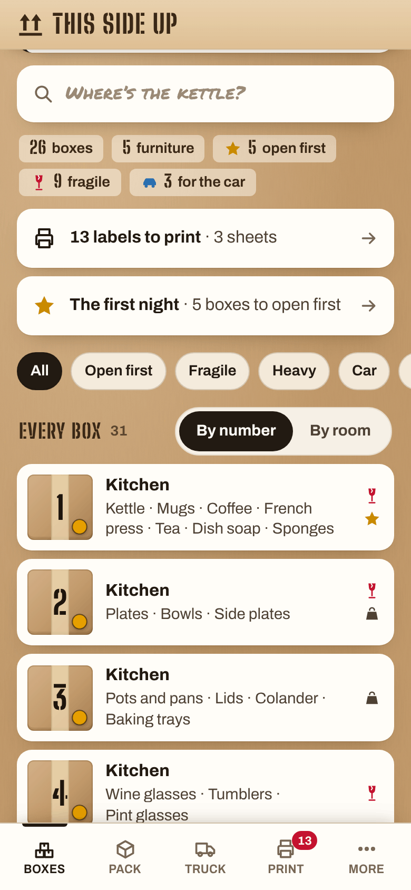
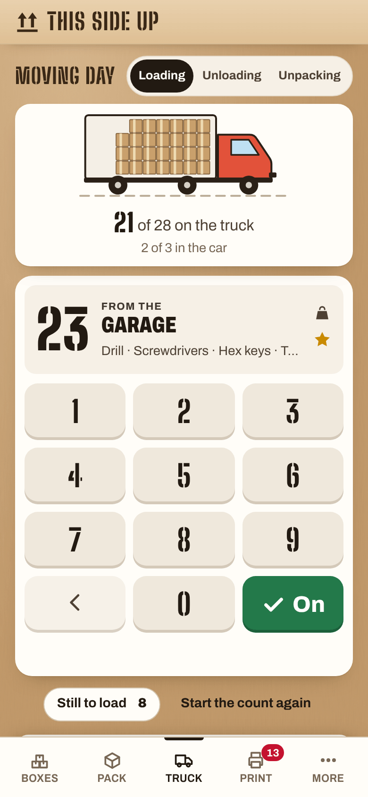

# This Side Up

**Use it: [this-side-up.junkdrawer.works](https://this-side-up.junkdrawer.works/)**

**Number every box in a move and know what's in each one.** Say what's in a box, which room it's leaving and which room it's going to, and whether it's fragile, heavy, to be opened first or going in the car. Print labels with a QR code any phone can read, tick the boxes onto the truck and off again on moving day, and find the kettle on the first night.

<p align="center">
  
  &nbsp;
  
  &nbsp;
  
</p>

## How it works

- **Pack.** Each box gets the next number (or any free number, to match a box you've already numbered elsewhere). Pick the room it's leaving and the room it's going to (Kitchen to Kitchen picks itself), list what's in it a line at a time, and tick Fragile, Heavy, Open first or Goes in the car. The label draws itself as you type, right above the list on a phone. Then the next box is ready, in the same rooms. A box half packed is kept as it's typed, through a reload, a look at another box or a phone that locks, until it's saved. Two tabs on one phone (the installed app and a tab a scanned label opened) share the list: each packs its own box, and what one saves the other picks up straight away.
- **Furniture counts too.** The sofa, the bed frame and the bike get numbers and labels like the boxes, so they're on the count.
- **Labels that look like the real thing.** A box number you can read across a garage, the room it's going to in its colour, a red FRAGILE stamp, OPEN FIRST, HEAVY and GOES IN THE CAR bands, the first few things inside, the this-way-up arrows and a QR code. They print true to size on Avery 5164/8164 (3⅓ × 4 in, six to a sheet), 5168 (3½ × 5 in, four) or 5126 half sheets (two, with a list of what's inside), or on plain Letter or A4 paper with cut lines. Each label works out what fits on it: the flags shrink to stay on one row, and what's inside gets the lines that are left and says how many more, so nothing ever covers the code. Start part-way down a sheet you've already used; after printing it asks whether they came out before marking them printed. A test sheet and nudges line them up with your printer.
- **A code any phone can read.** The label's QR code carries the box itself in its link, after the #: the number, the rooms, the flags and roughly the first 120 characters of what's inside, kept short enough (a version 10 code) to scan at about 1½ inches. Point any phone camera at it and it shows what's in the box and which room it goes to, with nothing to install. On a phone that has this move's list, it opens the box in the list instead.
- **Door signs.** One page per room at the new place, in that room's colour and shape, for taping on its door. The colours are Okabe and Ito's set, chosen so people with colour-blindness can tell them apart, and every room has its own shape too, so a box still matches its door on a black-and-white printer.
- **Moving day.** A big number pad for a thumb, with a box in the other arm (a keyboard works too). The whole pad fits above the tabs on a small phone, and no key moves from one box to the next. Key in a box's number as it goes onto the truck: it shows which box that is before you tick it, says so if there's no such box or it's already on, and turns amber for a box that goes in the car, with a Car key instead of On. At the other end it says which room to take each box to. Room by room, with a list of what's missing (by the room to look in), until the truck pulls away and "All 87 boxes made it".
- **Unpack and find things.** Tick boxes off as you empty them, on the box itself or on the same number pad (Unpacking), and watch the pile shrink room by room. Search covers everything: "kettle" → Box 12, Kitchen, open first.
- **The first night.** The boxes marked Open first, and a check that the sheets, the towels, the kettle, the chargers and the dog's bowl are actually in one of them.
- **NFC stickers.** With [Tag Along](https://junkdrawer.works/tag-along/) set to `https://this-side-up.junkdrawer.works/#box/`, each sticker opens its box here (`#box/012` is Box 12). A sticker for a box that isn't packed yet offers to pack it, with the sticker's number.
- **Two phones.** Send the whole list to another phone as a link, or save a backup file (with the box photos), and open it there. When both have changed things, send it again: the lists are merged box by box, the newer change to each box wins, ticks from the truck come through from both, and two boxes packed with the same number at once are flagged to renumber.
- **One set of box numbers.** If [Brickyard](https://brickyard.junkdrawer.works/) or [Parts Bin](https://parts-bin.junkdrawer.works/) already say a LEGO set or a bag of parts is in Box 12, give that box number 12 here too: any free number will do, not just the next one. The boxes after it carry on from where the count was (3, 4, 5…) and step over 12, so there are no gaps to explain to the movers.
- No account and no server. The list stays in your browser (and the photos in its IndexedDB) unless you send it. You can save it as a spreadsheet for the movers or the insurance. It works offline, in a new house with no Wi-Fi yet, and installs to a phone's home screen.

## Running it

It's a static site: plain HTML, CSS and JavaScript modules, with no build step.

```sh
npx serve .                   # or any static file server, then open the printed address
npm install                   # only for the tests and tools below: zxing-wasm (reads QR codes), upng-js (PNGs) and esbuild
npm test                      # the list, links, label sheets and QR codes (Node 20+), then the app in Chromium (needs Playwright)
node tools/screenshots.mjs    # redraws docs/*.png and og.png from the example move
node tools/make-icons.mjs     # redraws the PNG icons from icon.svg
npm run build                 # dist/this-side-up.html, the whole app in one file
```

The Chromium test also prints labels to PDF and reads every QR code back from where the Avery template says its label is, and prints a crowded move (two to four flags, a room it's leaving, long lists) on every sheet type and reads every code on every page. It uses `pdftoppm` and `pdfinfo` (poppler) for that part when they're installed, and skips it when they aren't.

To put it online with GitHub Pages: **Settings → Pages → Build and deployment → Deploy from a branch**, then pick `main` and `/ (root)`.

### Files

- `js/model.js`: the list. Boxes, furniture and rooms, cleaning up anything that arrives, the next number, search, what's missing on moving day, and merging two copies. It has no page code, so the tests run it in Node.
- `js/payload.js`: what goes in a link: a label's box (`#b/…`), a Tag Along number (`#box/12`) and the whole list (`#l/…`, squeezed with deflate).
- `js/rooms.js`: the room colours and shapes, and the usual room names. `js/sheets.js`: where each label sits on each kind of sheet.
- `js/labels.js`: the label, door signs and the test sheet, sized in em so one label works at any size, and `layout()`, which works out how big the flags can be and how many lines of contents fit on each label. `js/qr.js` draws QR codes with `js/vendor/qrcode.js`, Kazuhiko Arase's QR Code Generator (MIT), the same one While You Were Out uses.
- `js/app.js`: which screen goes with which address, and opening links that arrive. `js/home.js`: the welcome and the box list with search. `js/pack.js`: packing a box. `js/box.js`: one box, and what a phone shows when it reads a label. `js/print.js`: printing. `js/truck.js`: moving day. `js/first.js`: the first night. `js/places.js`: the rooms. `js/share.js` and `js/more.js`: another phone, backups and the spreadsheet.
- `js/store.js`: saving in the browser (the list in localStorage under `this-side-up.v1`, boxes being packed under `this-side-up.draft`, one for each tab, photos in IndexedDB). `js/ui.js` and `js/common.js`: pieces every screen uses. `js/example.js`: the example move.
- `fonts/`: Big Shoulders Stencil Display and Archivo (SIL Open Font License) and Permanent Marker (Apache License 2.0), served from here so nothing loads from elsewhere.
- `sw.js`: keeps a copy for using offline.
- `og.png`: the link preview, and `docs/`: the screenshots above, both made by `tools/screenshots.mjs`. `tools/make-icons.mjs` makes the icons from `icon.svg` and `tools/icon-full-bleed.svg`.
- `scripts/build.mjs`: bundles the app, fonts and all, into `dist/this-side-up.html`, and writes `dist/artifact.html`, the same page without its `<html>`, `<head>` and `<body>`, for a playable copy shown inside another page. Shown that way it hides or turns off the buttons that save a file, print or open the share sheet (a page in a frame can't), and its links and label codes point at this-side-up.junkdrawer.works. `dist/` isn't kept in the repo.
- `CNAME`, `carry.js`: This Side Up has its own address, this-side-up.junkdrawer.works, so it installs as its own app. It used to be at junkdrawer.works/this-side-up/, which forwards here with the part after the #, so labels and stickers made there still open their boxes. A browser keeps each address's saves apart, so the first time it opens here `carry.js` brings it all over from the old address: the list, the photos, the settings and any box left half packed.
- `test/unit.test.mjs` checks the list, search, merging, links and label sheets. `test/qr.test.mjs` draws every label's code the way a phone camera sees a 1½ inch code from about 25 cm (soft, noisy, turned) and reads it back with zxing-cpp. `test/e2e.mjs` packs a move, reads a label from the screen and from the printed PDF, counts the truck both ways (and checks no key moves between boxes on a 390 × 664 screen), moves the list between three phones, and uses two tabs on one phone at once.
